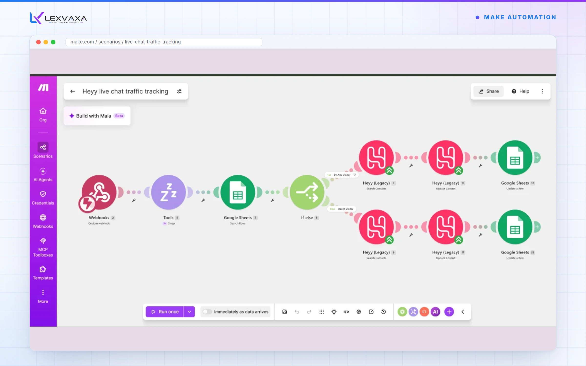

<!-- styled:v2 -->

**A Make automation that captures website activity and live chat data, routes it with conditional logic and organises it in Google Sheets.**

  
  
  
  
  
  
  

  <a href="#overview">Overview</a> ·
  <a href="#key-features">Key features</a> ·
  <a href="#results">Results</a> ·
  <a href="#tech-stack">Tech stack</a>

---

## Overview

Manual tracking and scattered data made website and chat activity hard to monitor. Lexvaxa built a Make automation that captures website activity and live chat events through webhooks, processes the chat data, routes each record with conditional logic and keeps everything organised in Google Sheets, with chat contacts updated automatically. Screens shown use sample data, so no client records are exposed.

## The challenge

Visitor and chat data was tracked by hand in different places, so nothing was complete or up to date.

## The solution

A Make scenario with webhooks, Google Sheets lookups, an if-else router and API calls that update chat contacts and sheets automatically.

## Key features

- Website activity tracking
- Live chat data processing
- Conditional routing for new and returning visitors
- Chat contacts searched and updated automatically
- Automated data organisation in Google Sheets

## Results

- One central workflow that reduces manual data handling

## Tech stack

    

## Privacy

Client names and records are confidential. Every screen in this repository uses sample data, and source code that belongs to the client is not published.

## Links

- Case study on Lexvaxa: https://lexvaxa.com/work/website-live-chat-tracking-make

---

**Built by [Ch Muhammad Samiullah](https://github.com/samiullah156-creator)** · AI Automation Engineer and Full-Stack Developer at [Lexvaxa](https://lexvaxa.com)

⭐ Star this repo if you found it useful

